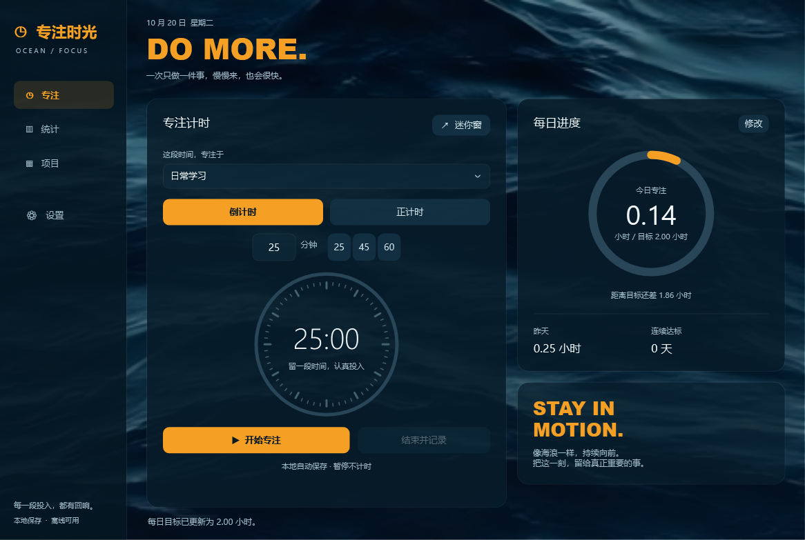
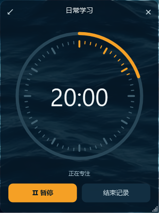

# 专注时光 · FocusTime

> 一款简单、离线、本地运行的 Windows 专注计时器。

选择一个项目，开始计时，把注意力留给正在做的事。

FocusTime 为学习、阅读、编程等需要持续投入的事情记录时间，支持正计时与倒计时，并用项目和累计统计展示每一段专注的积累。

**[下载 Windows 免安装版](https://github.com/Batman-hu/FocusTime/releases/latest)** · [使用说明](使用说明.md) · [反馈问题](https://github.com/Batman-hu/FocusTime/issues)



*截图中的统计数据为演示样例。首次使用从自己的记录开始。*

## 简单运行，安心专注

- **解压即用**：双击 `FocusTime.exe`，即可开始一段专注。
- **本地运行**：无需注册账号或部署服务，断网也可以使用。
- **本地保存**：项目、设置、专注记录和自动备份都保存在自己的电脑上。
- **围绕专注**：选项目、计时、暂停、结束，保持日常使用的简单直接。

## 功能介绍

| 功能 | 使用方式 |
| --- | --- |
| 正计时 | 从零开始记录，适合自由投入的学习与工作 |
| 倒计时 | 设置 1–1440 分钟，可快速选择 25 / 45 / 60 分钟 |
| 暂停与继续 | 暂停期间不累计时长，继续后接着记录 |
| 项目管理 | 新建、编辑、归档、恢复和删除；删除前自动备份 |
| 累计统计 | 以小时查看今日、本周、全部累计，以及近 7 天投入 |
| 项目筛选 | 按项目、今天、本周或本月回顾记录 |
| 置顶迷你窗 | 可拖动边缘调整宽高，左上角返回完整视图，支持暂停、继续和结束 |
| 每日目标 | 按小时设置目标，支持小数，通过圆环查看当天进度 |
| 自动保存 | 退出时保存草稿，重新打开后可手动继续 |
| CSV 导出 | 把全部专注记录导出为可用 Excel 打开的表格 |

倒计时结束会自动记录实际完成的专注；提前结束也会保留已经投入的时间。跨午夜的专注按自然日拆分统计，项目归档后仍保留历史时长。

## v1.2.0 更新

- 统计、每日进度和项目累计统一显示小时，45 分钟显示为 0.75 小时。
- 项目新增删除按钮；确认时显示受影响记录，删除前保存独立备份。
- 置顶小窗支持拖动四边和四角调整宽高，并记住上次尺寸。
- “返回完整视图”位于小窗最左上角，切换视图时继续计时。

## 快速开始

1. 在 [Releases](https://github.com/Batman-hu/FocusTime/releases/latest) 下载 `FocusTime-v1.2.0-Windows.zip`。
2. 解压到自己喜欢的位置。
3. 双击 `FocusTime.exe`。
4. 选择项目和计时方式，点击“开始专注”。

也可以直接下载仓库中的 [FocusTime.exe](https://github.com/Batman-hu/FocusTime/raw/refs/heads/main/FocusTime.exe)。背景已嵌入程序，单个可执行文件即可运行。

### 运行环境

- Windows 10 / Windows 11。
- 已启用 .NET Framework 4.8（常见 Windows 环境已具备）。
- 当前版本的数据位置为 `D:\FocusTime\Data`，需要有可写的 D 盘。

运行成品不需要安装 Python、Node.js 或 Visual Studio。

## 数据在自己的电脑上

| 目录 | 内容 |
| --- | --- |
| `D:\FocusTime\Data` | 项目、设置、历史记录、当前专注草稿与自动备份 |
| `D:\FocusTime\Exports` | CSV 默认导出目录 |
| `D:\FocusTime\Temp` | 自检临时数据，测试后自动清理 |

计时期间每 5 秒自动保存，开始、暂停、结束和正常退出时立即保存。正常关闭程序会暂停当前计时，重新打开后可继续。强制结束或突然断电时，最近约 5 秒可能还未保存。

项目删除会同时删除所属记录；删除前的完整快照保存在 `D:\FocusTime\Data\Backups`，恢复方法见使用说明。

完整备份时，先关闭程序，再复制 `D:\FocusTime\Data` 文件夹即可。D 盘不可用时会提示启动失败，不会自动改存到其他盘。

## 界面预览

深海海浪背景、橙色重点与置顶小窗，让界面安静地陪伴每一段专注。

### 累计统计


### 迷你专注窗



## 从源码运行

下载仓库后，双击 `Launch.cmd`。脚本使用 Windows 自带的 .NET Framework 编译器进行离线编译，核心自检通过后打开程序。

双击 `Test.cmd` 可执行核心与界面检查。当前版本已通过 41 项核心检查，以及实际计时推进、暂停续计、倒计时完成、项目操作、统计筛选、数据重新读取、删除确认与失败回滚、迷你窗缩放与尺寸恢复等界面检查。

```text
FocusTime.exe        Windows 免安装程序
Launch.cmd           编译并启动
Test.cmd             编译并执行自检
source/
  App.cs             桌面界面
  Core.cs            计时、数据保存、统计与 CSV
  Tests.cs           核心自检
  Build.ps1          离线编译入口
docs/screenshots/    演示截图
```

## 当前范围

当前发布 Windows 桌面版。电脑休眠或计时回调停顿超过 10 秒时会自动暂停；切换应用、锁屏或最小化仍继续计时。程序提供专注计时与记录，不切换系统勿扰模式。

## 致谢

介绍的组织方式参考了 [Traclock（时迹）](https://github.com/MeanZhang/Traclock) 的简介、功能和截图展示方式。FocusTime 的功能说明以本仓库的 Windows 版本为准。

海浪背景来自使用者提供的界面参考素材；图像资源与程序源码分别保留其原有权利归属。
